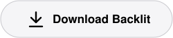
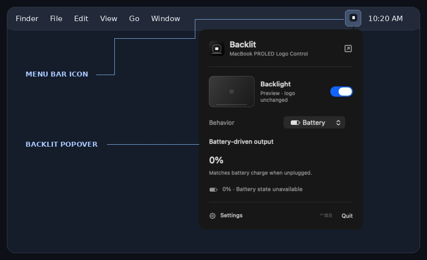
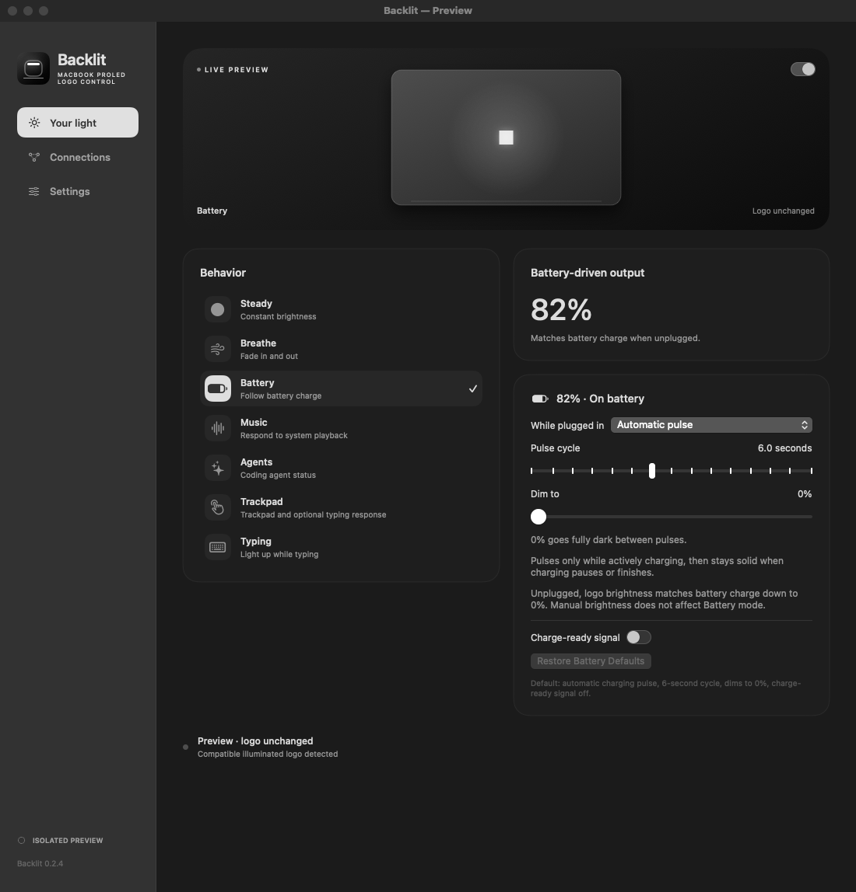
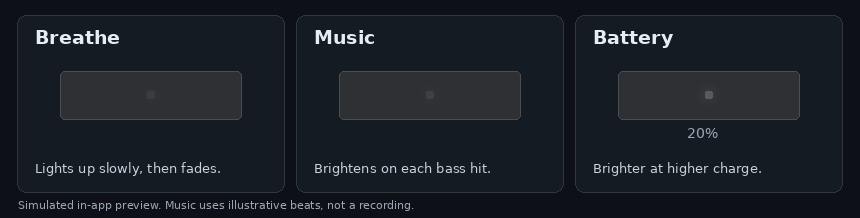
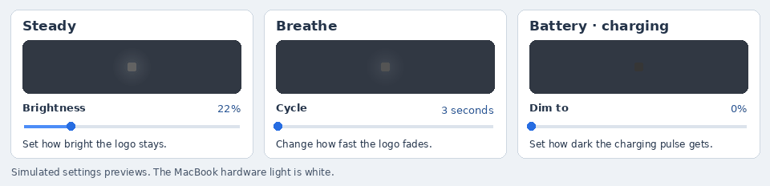
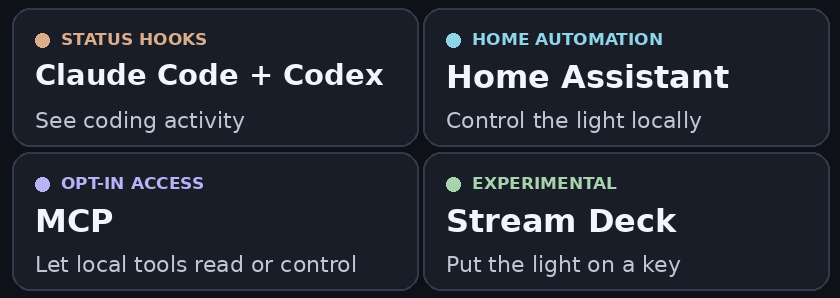
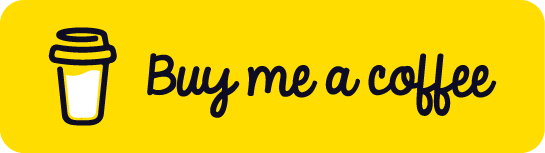

Make your MacBook’s illuminated Apple logo yours. Let it breathe, react to music, or show when your coding agent needs you. No account required.

## Get Backlit

For compatible **MacBook Pro with PROLED XDR** and an illuminated logo. [Installation & compatibility](docs/USER-GUIDE.md#install-and-update) · [All releases](https://github.com/t0nyz0/Backlit/releases)

## One click from the macOS menu bar

Toggle the light and switch modes without leaving what you’re doing.

*Illustrated menu bar with a native dark-mode popover captured offscreen from a 0.2.12 development build. Battery data is unavailable in this isolated preview.*

## Backlit main window

Pick a mode and tune the glow.

*Historical Backlit 0.2.5 isolated capture; some layouts have changed. [Capture details](docs/media/README.md).*

## See the light in action

*Illustrative loops, not hardware footage. Music uses simulated bass hits; Battery shows unplugged examples.*

## What the controls change

*Illustrated controls; not a screen recording.*

## Seven ways to light up

**Steady** · **Breathe** · **Battery** · **Music** · **Agents** · **Trackpad** · **Typing**

White light only. Music and Typing use [optional macOS permissions](docs/USER-GUIDE.md#behavior-details-and-permissions).

## Connections

[Setup & current limits](docs/USER-GUIDE.md#connection-setup-and-limits) · Live Codex hook delivery is unverified.

---

**0.2.11 (build 57)** · [Ten interface languages](docs/LOCALIZATION.md) · [User guide](docs/USER-GUIDE.md) · [Build from source](docs/USER-GUIDE.md#build-from-source) · [Download stats](docs/downloads/README.md)

[Privacy](docs/PRIVACY.md) · [Validation](docs/VALIDATION.md) · [Security](.github/SECURITY.md) · [Attribution and trademark notices](docs/USER-GUIDE.md#license-and-attribution) · [PolyForm Perimeter license](LICENSE)

Made with care by <a href="https://t0nyz.com">t0nyz</a>.

