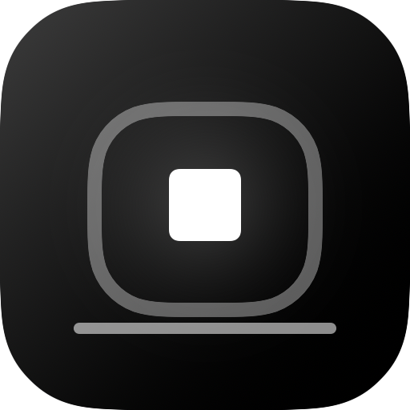
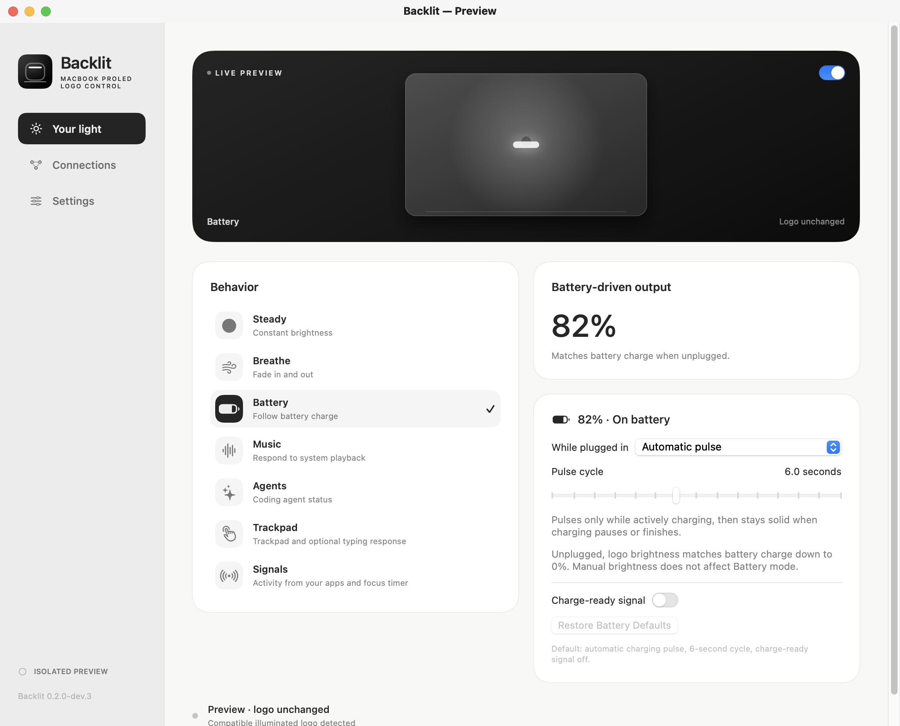
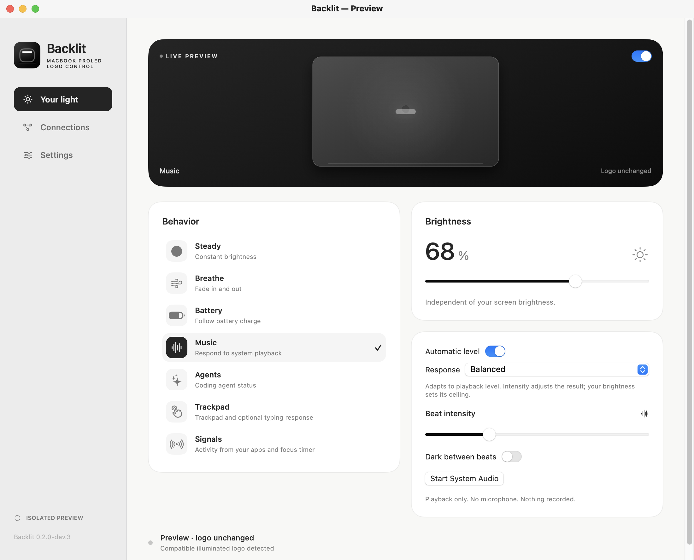
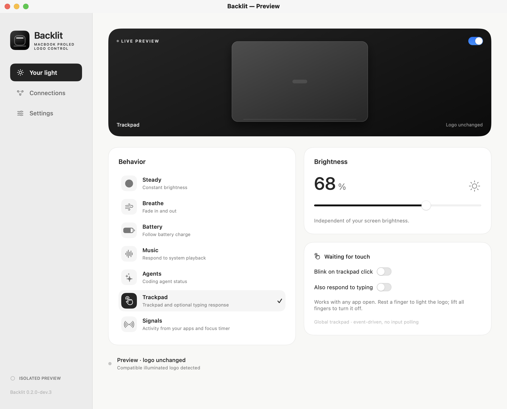
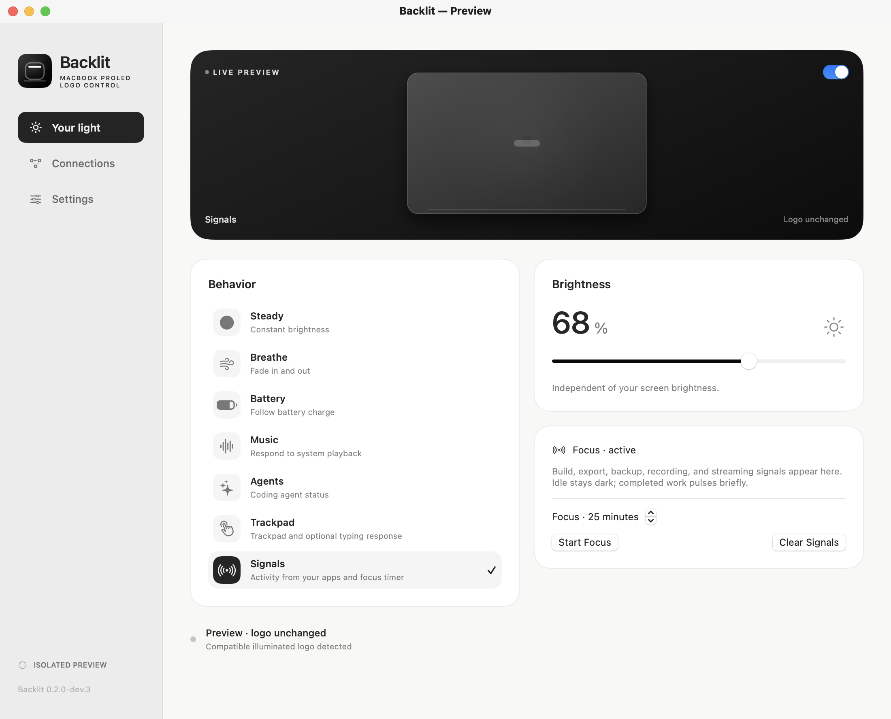
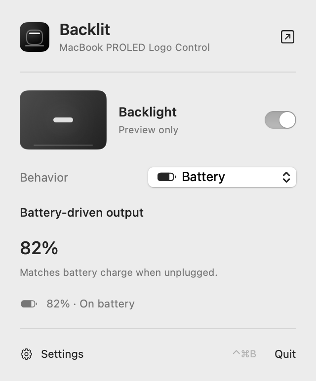
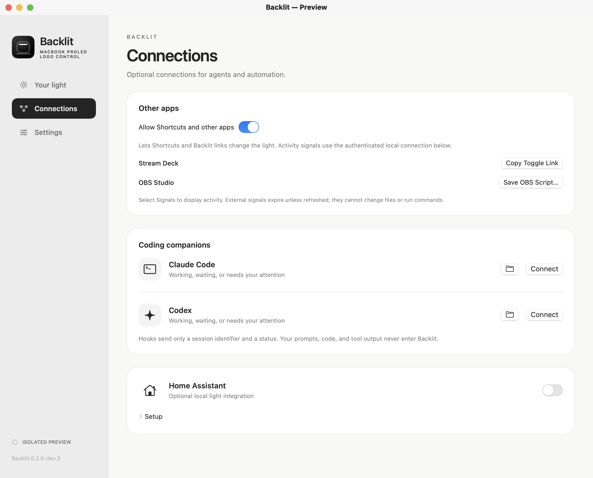
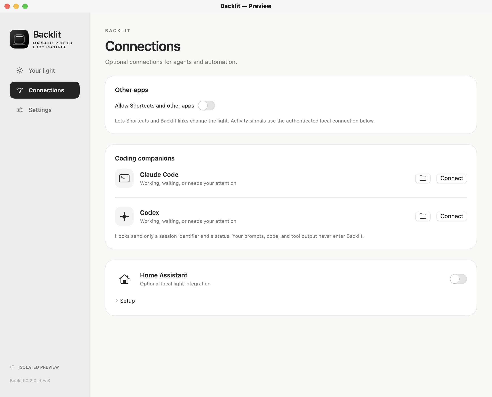
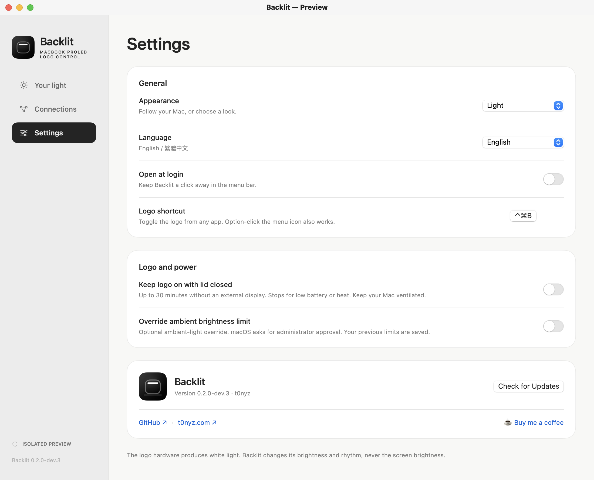

Development checkout: **0.2.0-dev.3** (local testing build). Public downloads below remain the published release.

<p align="center"></p>
<h1 align="center">Backlit</h1>
<p align="center">MacBook PROLED logo light control for macOS.</p>
<p align="center">


<a href="LICENSE"></a>
</p>

Control the brightness of a compatible MacBook PROLED’s illuminated Apple logo from the menu bar. Backlit is a native Swift app with an original interface, local processing, and no account requirement.

<picture>
  <source media="(prefers-color-scheme: dark)" srcset="docs/media/light-dark.png">
  
</picture>

*Screenshots show the running native app in isolated preview. The illustrated light is a preview, not a hardware measurement. [Provenance](docs/media/README.md).*

## Behaviors

| Behavior | What it does |
| --- | --- |
| Steady | Holds the brightness you choose. |
| Breathe | Fades in and out on a 3–10 second cycle. |
| Battery | Automatic pulse only while actively charging; solid at full or paused charging. Unplugged, output equals the battery percentage down to zero. Manual brightness has no effect. Includes pulse speed, optional plugged-in styles, and charge-ready cues. |
| Music | Responds to bass energy in system playback, with automatic level adjustment, Smooth/Balanced/Punchy response, sensitivity, and dark-between-beat controls. |
| Agents | Shows working, waiting, and attention states from coding agents. |
| Trackpad | Lights while a finger rests on the trackpad, with any app open. Optional click blink and permission-gated typing response. |
| Signals | Displays bounded activity/progress signals from apps and a local Focus timer. |

Battery mode displays **Battery-driven output** in the workspace and menu, without a manual brightness slider. Switching to another mode restores its saved manual brightness. Optional Battery styles and brief charge-ready signals can override the automatic charging pattern.

The logo supports white light. Brightness and timing are adjustable; RGB colors and pixel animations are not supported.

<details>
<summary>Music, Trackpad and Signals screenshots</summary>





</details>

## Menu bar

<p align="center"></p>

The menu includes a small preview and controls for the selected behavior. Battery shows its actual battery-driven output; the other behaviors retain manual brightness. Backlit’s own outlined status icon remains visible when dim; its center follows current output. **Control–Command–B** or **Option-click** toggles the light. The shortcut is configurable.

Launch connects compatible hardware automatically. Quit restores the previous logo curve. If restoration fails, Backlit retains a recovery record and offers Restore Light.

## Connections

Claude Code and Codex have separate, reversible status hooks. Existing hooks are preserved. They send a session identifier and status—not prompts, code, or tool output. Codex requires hook review/trust in its settings. Codex live-session compatibility remains unverified.

Opt-in local automation links, a separately packaged Stream Deck plugin, and an OBS script are included. Activity signals cover build, export, backup, focus, recording, and streaming. They are experimental: real Stream Deck/OBS operation and native Shortcuts discovery have not passed acceptance testing. The five native Shortcuts actions are not discoverable in the current ad-hoc signing setup; extracted metadata alone does not establish availability.

<details>
<summary>Other apps screenshot</summary>



</details>

An optional [Home Assistant integration](docs/HOME-ASSISTANT.md) exposes a light and status sensors over a local, authenticated connection. It is off by default.

<details>
<summary>Connections screenshot</summary>

<picture>
  <source media="(prefers-color-scheme: dark)" srcset="docs/media/connections-dark.png">
  
</picture>

</details>

## Settings

<picture>
  <source media="(prefers-color-scheme: dark)" srcset="docs/media/settings-dark.png">
  
</picture>

## Install

Download the Apple silicon ZIP or DMG from [Releases](https://github.com/t0nyz0/Backlit/releases). Quit any running Backlit, then put the new app in **Applications**. This early release is **ad-hoc signed, not Developer ID signed or notarized**.

A physically illuminated, independently controlled logo is required. The macOS 14 deployment target is not a claim that every older Mac/OS is supported. Unsupported hardware can use preview mode.

Music starts only after you enable system audio and macOS permits it. On macOS 14.2+, a private Core Audio tap captures playback without display/window capture or microphone input. No audio is saved or uploaded.

Optional login launch, closed-lid operation, and an administrator-authorized brightness-limit override are in Settings. Closed-lid and administrator behavior still need physical validation. Global screen-touch detection is not included. See [validation and known limits](docs/VALIDATION.md).

## Updates

The in-app updater uses Sparkle, but is **disabled in this development build** because a publisher trust key and signed feed have not been provisioned. It does not fall back to installing unsigned GitHub downloads. Existing published versions need a trusted manual installation to acquire the updater and its public trust key. Authentic update installation, interruption recovery, and rollback have not been tested end to end. Same-source SHA-256 checksums detect changed bytes; they do not prove publisher identity.

## Build

```sh
git clone https://github.com/t0nyz0/Backlit.git
cd Backlit
swift test
bash scripts/build.sh
bash scripts/install.sh
```

The local installer gracefully quits, replaces, and reopens `/Applications/Backlit.app`. Preferences are preserved. For UI work without hardware writes:

```sh
open -n dist/Backlit.app --args --preview
```

The [GitHub Actions workflow](https://github.com/t0nyz0/Backlit/actions) defines tests, privacy/secret checks, and an optimized build. **This development candidate has been checked locally; its exact commit has not run in remote CI.** The release workflow packages ZIP, DMG, clean source, build metadata, and SHA-256 checksums when an authorized version tag is published. [Contributing](CONTRIBUTING.md) covers packaging and Home Assistant tests.

[Privacy](docs/PRIVACY.md) · [Validation](docs/VALIDATION.md) · [Security](SECURITY.md) · [Attribution](docs/ATTRIBUTION.md)

Backlit is independent of Apple, Anthropic, OpenAI, Home Assistant, Backglow, and LidPulse. Their names and marks belong to their owners. Backlit’s original code and artwork use [PolyForm Perimeter 1.0.0](LICENSE), a source-available license that restricts competing reuse. Third-party marks and the coffee badge are excluded.

---

<p align="center">Made with care by <a href="https://t0nyz.com">t0nyz</a>.</p>
<p align="center"><a href="https://buymeacoffee.com/tonyz"></a></p>
