

MacBook Pro with PROLED XDR · Apple silicon · No account required




 

 






Lid drawings are illustrations, not hardware footage. The menu bar popover is a native capture from a 0.2.12 development build in isolated preview, where battery data is unavailable. The main window is a historical 0.2.5 isolated capture, and some layouts have changed ([capture details](docs/media/README.md)). White light only. Music and Typing use [optional macOS permissions](docs/USER-GUIDE.md#behavior-details-and-permissions). The built-in screen may remain lit while the lid is closed. The Stream Deck add-on is experimental, and live Codex hook delivery is unverified ([setup and current limits](docs/USER-GUIDE.md#connection-setup-and-limits)).

---

**0.2.11 (build 57)** · [Ten interface languages](docs/LOCALIZATION.md) · [User guide](docs/USER-GUIDE.md) · [Installation & compatibility](docs/USER-GUIDE.md#install-and-update) · [All releases](https://github.com/t0nyz0/Backlit/releases) · [Build from source](docs/USER-GUIDE.md#build-from-source) · [Download stats](docs/downloads/README.md)

[Privacy](docs/PRIVACY.md) · [Validation](docs/VALIDATION.md) · [Security](.github/SECURITY.md) · [Attribution and trademark notices](docs/USER-GUIDE.md#license-and-attribution) · [License](LICENSE)

Made with care by <a href="https://t0nyz.com">t0nyz</a>.

